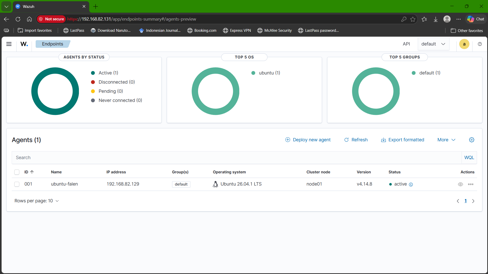
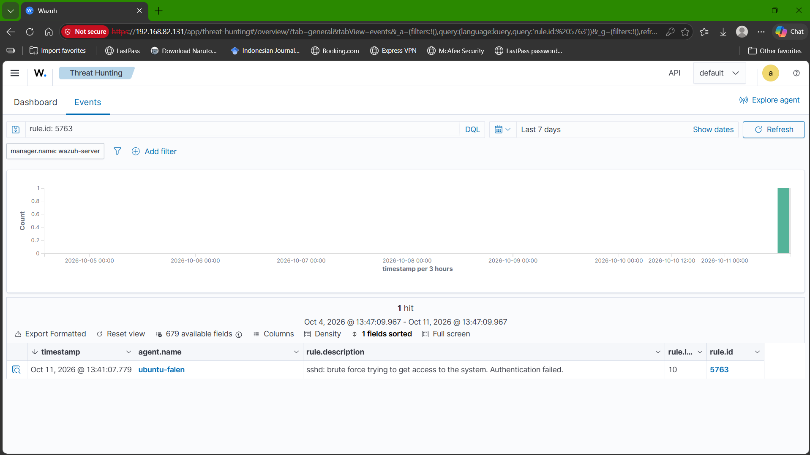
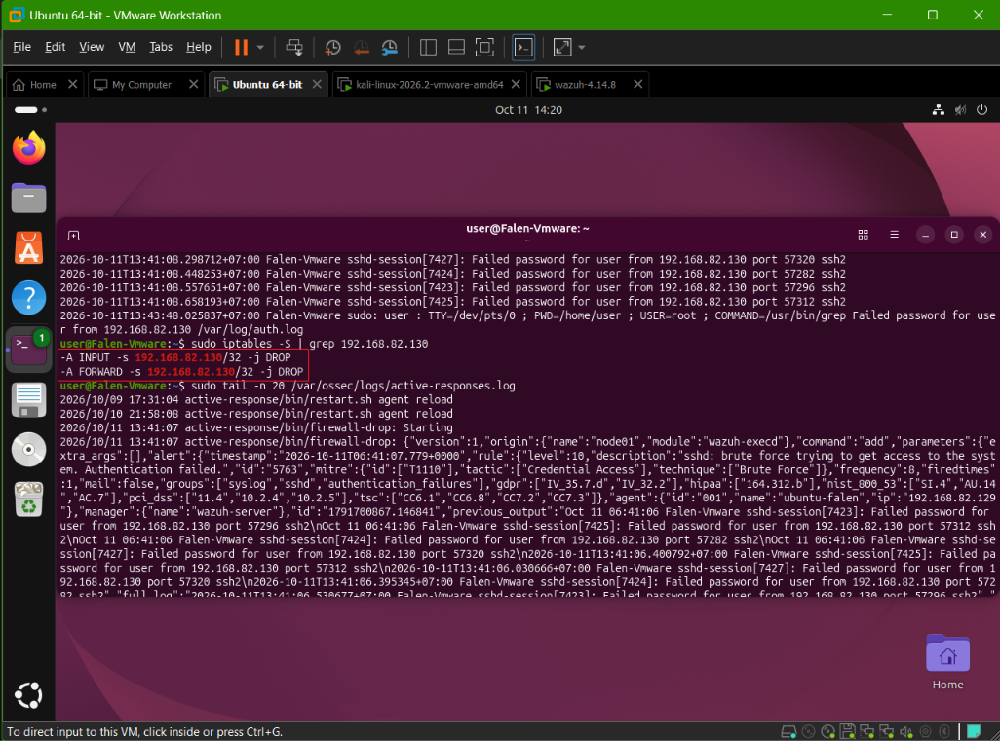

# Linux Security Monitoring & Incident Response

Proyek portofolio cybersecurity berbasis lab yang mencakup pemantauan autentikasi Linux, pengembangan deteksi dengan Python, pemantauan SIEM terpusat menggunakan Wazuh, investigasi insiden, containment sementara, dan verifikasi pemulihan.

**Bahasa:** [English](README.md) | Bahasa Indonesia

## Gambaran Proyek

Proyek ini terdiri dari dua fase:

- **Phase 1 - Custom Log Detection:** skrip Python menganalisis `/var/log/auth.log` pada Ubuntu, mengorelasikan kegagalan autentikasi SSH berdasarkan IP sumber dan username, menerapkan sliding time window, lalu mengekspor alert ke JSON.
- **Phase 2 - Wazuh SIEM / Active Response:** deployment Wazuh self-hosted mengumpulkan event autentikasi dari endpoint Ubuntu, mendeteksi pola SSH brute-force, dan menjalankan respons firewall sementara.

## Arsitektur Lab

```text
Kali Linux - sumber simulasi
192.168.82.130
        |
        | Percobaan autentikasi SSH terkontrol
        v
Endpoint Ubuntu - Falen-Vmware
192.168.82.129
        |
        | Wazuh Agent: ubuntu-falen (ID 001)
        v
Wazuh server - 192.168.82.131
  ├── Wazuh Manager
  ├── Wazuh Indexer
  └── Wazuh Dashboard
```

Semua alamat tersebut adalah alamat privat dalam lab VMware terkontrol, bukan alamat sumber serangan dari internet.

## Phase 1 - Python Authentication Log Monitor

### Konfigurasi deteksi

- Sumber log: `/var/log/auth.log`
- Ambang batas: 5 kegagalan autentikasi
- Jendela waktu: 5 menit
- Kunci korelasi: IP sumber + username
- Analisis berbatas waktu melalui `--since` dan `--until`
- Output ringkasan di terminal dan alert JSON

### Cara menjalankan

Python 3.7 atau lebih baru, hanya memakai pustaka standar (tanpa dependensi). Untuk mereproduksi hasil yang tercatat dari evidence yang tersimpan:
```bash
python3 log_monitor.py \
  --log evidence/ssh-auth-log.txt \
  --since 2026-09-25T17:59:00+07:00 \
  --until 2026-09-25T18:04:30+07:00 \
  --threshold 5 --window 5 \
  --output alerts.json
```
Pada host Ubuntu langsung, arahkan `--log` ke `/var/log/auth.log` (membutuhkan root atau keanggotaan grup `adm`). `--since` dan `--until` menerima timestamp ISO 8601, nilai tanpa offset UTC dianggap waktu lokal

### Hasil yang tercatat

Pada periode analisis `2026-09-25T17:59:00+07:00` sampai `2026-09-25T18:04:30+07:00`, detektor mencatat:

- 10 event kegagalan autentikasi SSH
- 1 event autentikasi SSH diterima
- 0 perintah sudo dalam periode analisis
- 1 alert brute-force dari `192.168.82.130` terhadap username `test`

Autentikasi yang diterima menggunakan public key untuk akun `user`, detektor tidak salah mengklasifikasikannya sebagai kompromi kata sandi.

Evidence: `evidence/monitor-output.txt`, `evidence/alerts.json`, dan `evidence/ssh-auth-log.txt`. Baca [analisis deteksi Phase 1](findings/detection-analysis.id.md) untuk tujuan, konfigurasi, simulasi, hasil, batasan, dan pertimbangan keamanan. Versi bahasa Inggris tersedia di [findings/detection-analysis.md](findings/detection-analysis.md).

## Phase 2 - Deteksi dan Respons Wazuh

Simulasi Phase 2 menggunakan username `user` dengan kata sandi yang salah. Ini berbeda dari simulasi Phase 1 yang menghasilkan alert untuk username `test`.

- Agent: `ubuntu-falen`, ID `001`, status **Active**
- Sumber: Kali Linux, `192.168.82.130`
- Target: SSH Ubuntu, `192.168.82.129`
- Rule Wazuh: `5763`, level `10`
- Frekuensi pada ruleset terpasang: 8 event dalam 120 detik
- MITRE ATT&CK: `T1110 - Brute Force`
- Hasil Hydra: `0 valid password found`
- Active Response: `firewall-drop`

### Agent Wazuh aktif



### Alert brute-force



### Active Response dan firewall block



Lihat [laporan investigasi dan respons insiden](findings/incident-response-report.id.md) untuk timeline, temuan, screenshot bukti, dan batasan analisis. Versi bahasa Inggris ada di [findings/incident-response-report.md](findings/incident-response-report.md).

## Verifikasi Pemulihan

File verifikasi akhir mencatat:

- Layanan SSH: `active`
- Wazuh Agent: `active`
- `PasswordAuthentication no`
- `MaxAuthTries 3`
- Tidak ada firewall block aktif untuk `192.168.82.130`

Screenshot `nc` dari Kali menunjukkan TCP/22 berstatus `open`. Pesan `inverse host lookup failed` sebelumnya adalah kegagalan pencarian reverse DNS, bukan kegagalan koneksi TCP. Log Active Response mencatat firewall block dicabut pada 13:44:08 WIB, 181 detik setelah dipasang. VM Kali memakai UTC-4 sedangkan Ubuntu dan Wazuh memakai WIB (UTC+7), laporan menjelaskan bagaimana kedua jam tersebut dicocokkan.

## Struktur Repository

```text
linux-security-monitoring-incident-response/
├── README.md
├── README.id.md
├── log_monitor.py
├── sshd_config.before-simulation
├── evidence/
│   ├── alerts.json
│   ├── monitor-output.txt
│   ├── ssh-auth-log.txt
│   ├── sudo-activity.txt
│   ├── screenshots/                 # 9 screenshot unik Phase 2 dengan nama deskriptif
│   └── phase2-wazuh/
│       ├── attempt1-start.txt
│       ├── attempt1-end.txt
│       ├── attempt1-throttled-auth.log
│       ├── incident-start.txt
│       ├── incident-end.txt
│       ├── ssh-incident-auth.log
│       ├── source-ip-investigation.log
│       ├── response-verification.txt
│       ├── active-responses-excerpt.log
│       └── backup konfigurasi
└── findings/
    ├── detection-analysis.md
    ├── detection-analysis.id.md
    ├── incident-timeline.md
    ├── incident-timeline.id.md
    ├── incident-response-report.md
    ├── incident-response-report.id.md
    └── final-structure-check.md
```

## Ruang Lingkup dan Batasan

Ini adalah demonstrasi lab dengan satu endpoint, bukan deployment SOC produksi. Proyek ini tidak mencakup integrasi identity perusahaan, sistem tiket terpusat, korelasi multi-endpoint, atau platform SOAR terpisah. Kesimpulan dibatasi pada log dan screenshot yang dikumpulkan dalam lab ini.

## Keterampilan yang Ditunjukkan

Analisis log autentikasi Linux, scripting Python, deteksi berbasis ambang batas, pembuatan evidence JSON, pengoperasian Wazuh Agent/Manager, peninjauan alert SIEM, pemetaan MITRE ATT&CK, Active Response, verifikasi firewall, analisis timeline insiden, pemulihan hardening SSH, dan penulisan laporan teknis.

