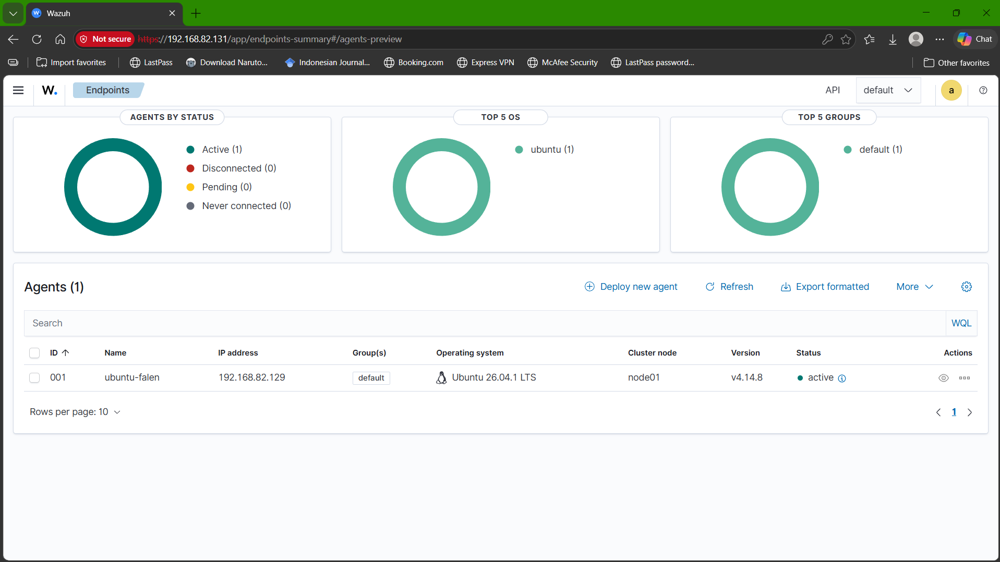
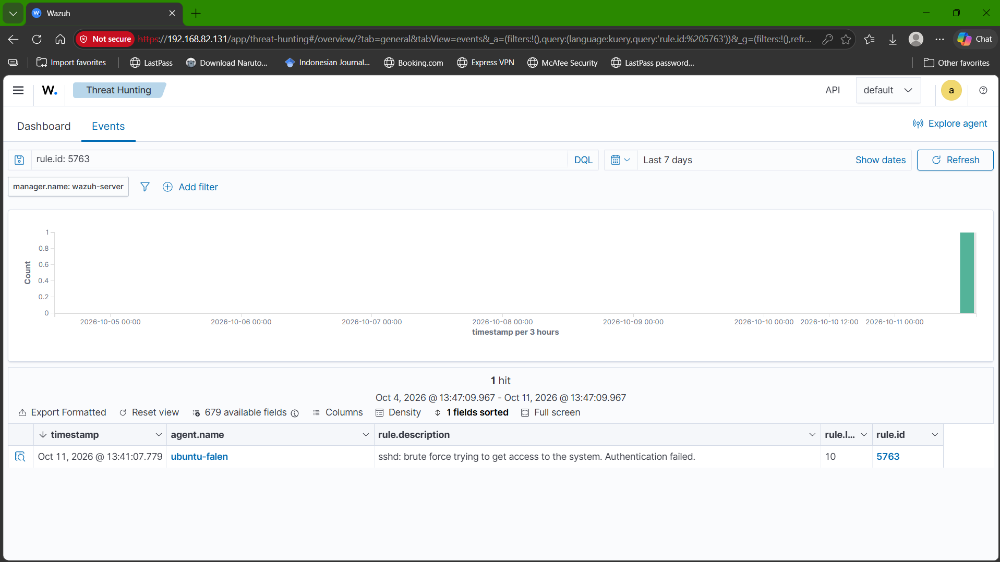
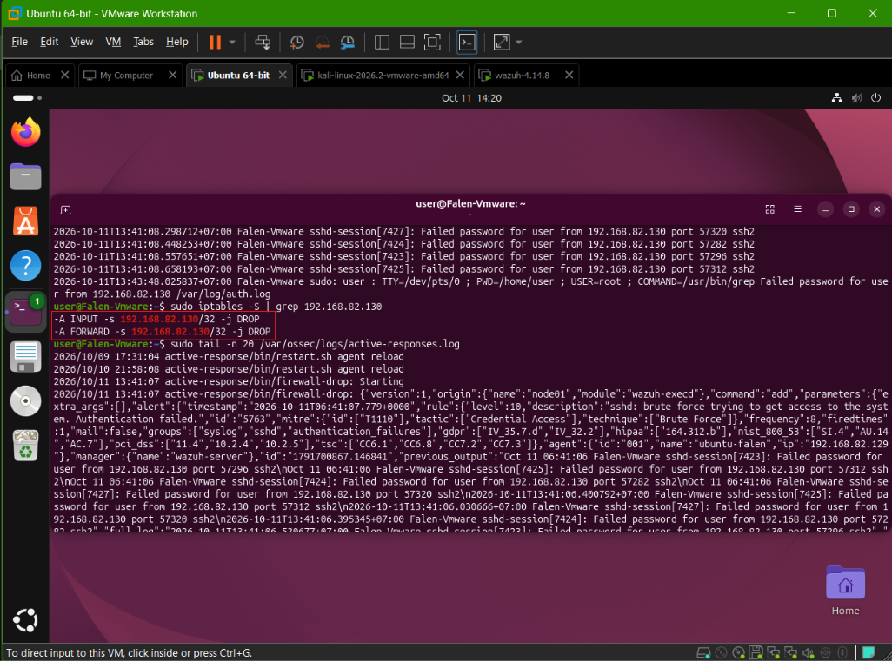

# Linux Security Monitoring & Incident Response

A hands-on cybersecurity portfolio project covering host-based authentication monitoring, Python detection engineering, centralized SIEM monitoring with Wazuh, incident investigation, temporary containment, and recovery verification.

**Language:** English | [Bahasa Indonesia](README.id.md)

## Project Overview

This project is organized into two phases:

- **Phase 1 - Custom Log Detection:** a Python script analyzes Ubuntu `/var/log/auth.log`, correlates failed SSH authentication attempts by source IP and username, applies a sliding time window, and exports alerts as JSON.
- **Phase 2 - Wazuh SIEM / Active Response:** a self-hosted Wazuh deployment collects authentication events from the Ubuntu endpoint, detects an SSH brute-force pattern, and invokes a temporary firewall response.

## Lab Architecture

```text
Kali Linux - simulation source
192.168.82.130
        |
        | Controlled SSH authentication attempts
        v
Ubuntu endpoint - Falen-Vmware
192.168.82.129
        |
        | Wazuh Agent: ubuntu-falen (ID 001)
        v
Wazuh server - 192.168.82.131
  ├── Wazuh Manager
  ├── Wazuh Indexer
  └── Wazuh Dashboard
```

All addresses belong to the private, controlled VMware lab, they are not public attack sources.

## Phase 1 - Python Authentication Log Monitor

### Detection configuration

- Log source: `/var/log/auth.log`
- Threshold: 5 failed authentication attempts
- Sliding time window: 5 minutes
- Correlation key: source IP + username
- Time-bounded analysis via `--since` and `--until`
- Human-readable console output and JSON alert output

### Usage

Python 3.7 or newer, standard library only (no dependencies). To reproduce the recorded result from the saved evidence:

```bash
python3 log_monitor.py \
  --log evidence/ssh-auth-log.txt \
  --since 2026-09-25T17:59:00+07:00 \
  --until 2026-09-25T18:04:30+07:00 \
  --threshold 5 --window 5 \
  --output alerts.json
```

On a live Ubuntu host, point `--log` to `/var/log/auth.log` (reading it requires root or membership in the `adm` group). `--since` and `--until` accept ISO 8601 timestamps, values without a UTC offset are interpreted as local time.

### Recorded result

For the analysis window `2026-09-25T17:59:00+07:00` through `2026-09-25T18:04:30+07:00`, the detector recorded:

- 10 failed SSH authentication events
- 1 accepted SSH authentication event
- 0 sudo commands in the analyzed window
- 1 brute-force alert for source `192.168.82.130` and username `test`

The accepted authentication used public-key authentication for `user`, the detector did not misclassify it as a successful password compromise.

Evidence: `evidence/monitor-output.txt`, `evidence/alerts.json`, and `evidence/ssh-auth-log.txt`. See the [Phase 1 detection analysis](findings/detection-analysis.md) for the detection objective, configuration, simulation, results, limitations, and security considerations. An Indonesian version is available at [findings/detection-analysis.id.md](findings/detection-analysis.id.md).

## Phase 2 - Wazuh Detection and Response

The controlled Phase 2 simulation targeted username `user` using incorrect passwords. This is separate from the Phase 1 simulation, which triggered an alert for username `test`.

- Agent: `ubuntu-falen`, ID `001`, status **Active**
- Source: Kali Linux, `192.168.82.130`
- Target: Ubuntu SSH, `192.168.82.129`
- Wazuh rule: `5763`, level `10`
- Rule frequency in installed ruleset: 8 events within 120 seconds
- MITRE ATT&CK: `T1110 - Brute Force`
- Hydra result: `0 valid password found`
- Active Response: `firewall-drop`

### Wazuh agent active



### Brute-force alert



### Active Response and firewall block



See the [incident investigation and response report](findings/incident-response-report.md) for the detailed timeline, findings, inline evidence, and limitations. An Indonesian version is available at [findings/incident-response-report.id.md](findings/incident-response-report.id.md).

## Recovery Verification

The saved final verification reports:

- SSH service: `active`
- Wazuh Agent: `active`
- `PasswordAuthentication no`
- `MaxAuthTries 3`
- No active firewall block for `192.168.82.130`

The Kali `nc` screenshot reports TCP/22 as `open`. Its preceding `inverse host lookup failed` message is a reverse-DNS lookup issue, not a failed TCP connection. The Active Response log records the firewall block being removed at 13:44:08 WIB, 181 seconds after it was added. The Kali VM runs on UTC-4 while Ubuntu and Wazuh use WIB (UTC+7), the report explains how the two clocks line up.

## Repository Structure

```text
project3-final/
├── README.md
├── README.id.md
├── log_monitor.py
├── sshd_config.before-simulation
├── evidence/
│   ├── alerts.json
│   ├── monitor-output.txt
│   ├── ssh-auth-log.txt
│   ├── sudo-activity.txt
│   ├── screenshots/                 # 9 unique Phase 2 screenshots with descriptive filenames
│   └── phase2-wazuh/
│       ├── attempt1-start.txt
│       ├── attempt1-end.txt
│       ├── attempt1-throttled-auth.log
│       ├── incident-start.txt
│       ├── incident-end.txt
│       ├── ssh-incident-auth.log
│       ├── source-ip-investigation.log
│       ├── response-verification.txt
│       ├── active-responses-excerpt.log
│       └── configuration backups
└── findings/
    ├── detection-analysis.md
    ├── detection-analysis.id.md
    ├── incident-timeline.md
    ├── incident-timeline.id.md
    ├── incident-response-report.md
    ├── incident-response-report.id.md
    └── final-structure-check.md
```

## Scope and Limitations

This is a single-endpoint lab demonstration, not a production SOC deployment. It does not include enterprise identity integration, a central ticketing system, multi-endpoint correlation, or a separate SOAR platform. Conclusions are limited to the logs and screenshots collected in this lab.

## Skills Demonstrated

Linux authentication log analysis, Python scripting, threshold-based detection, JSON evidence generation, Wazuh agent/manager operation, SIEM alert review, MITRE ATT&CK mapping, Active Response, firewall verification, incident timeline analysis, SSH hardening restoration, and technical reporting.

