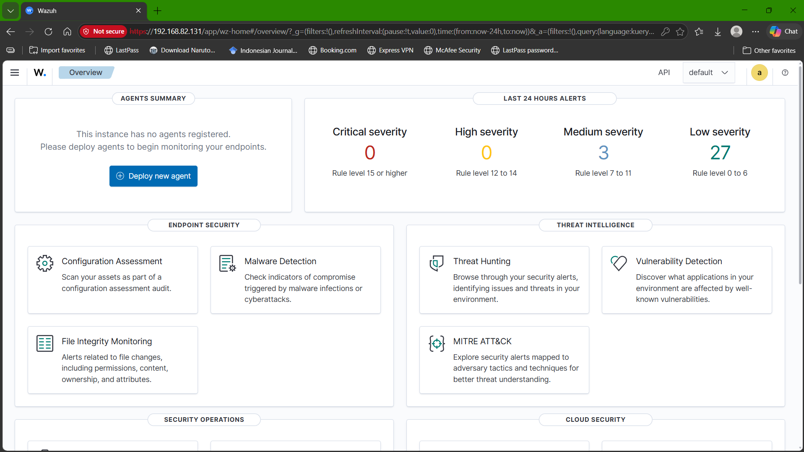
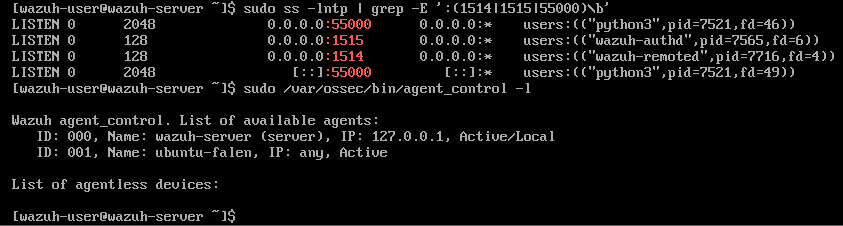
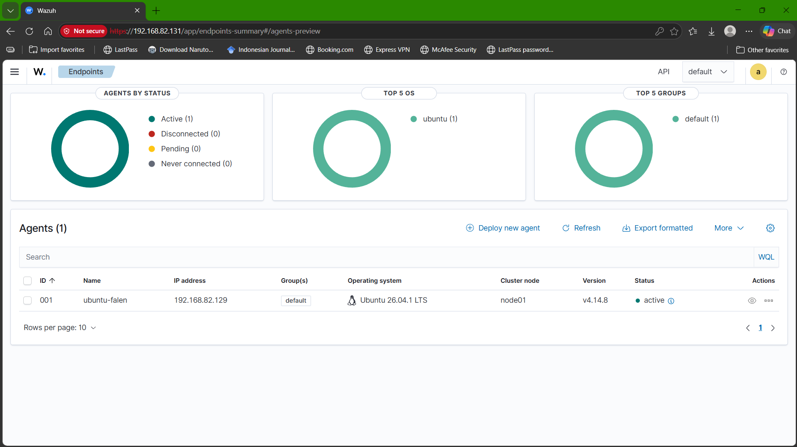
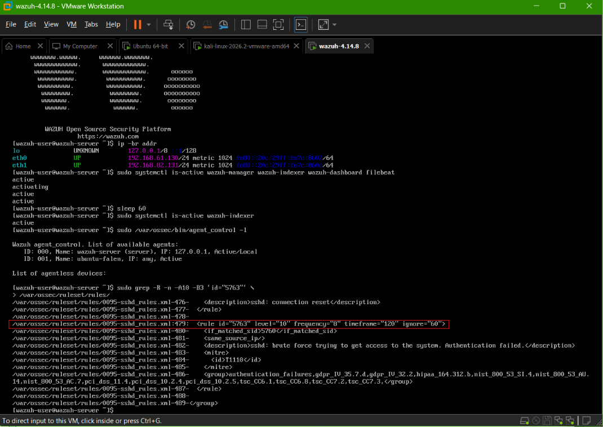
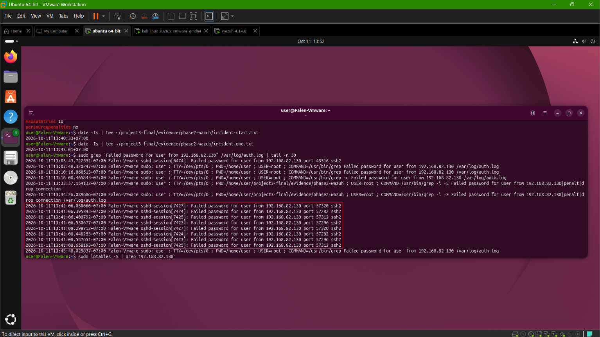
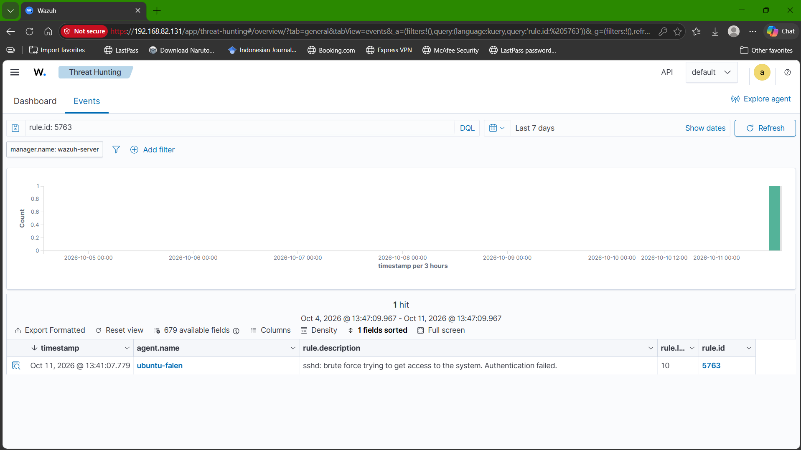
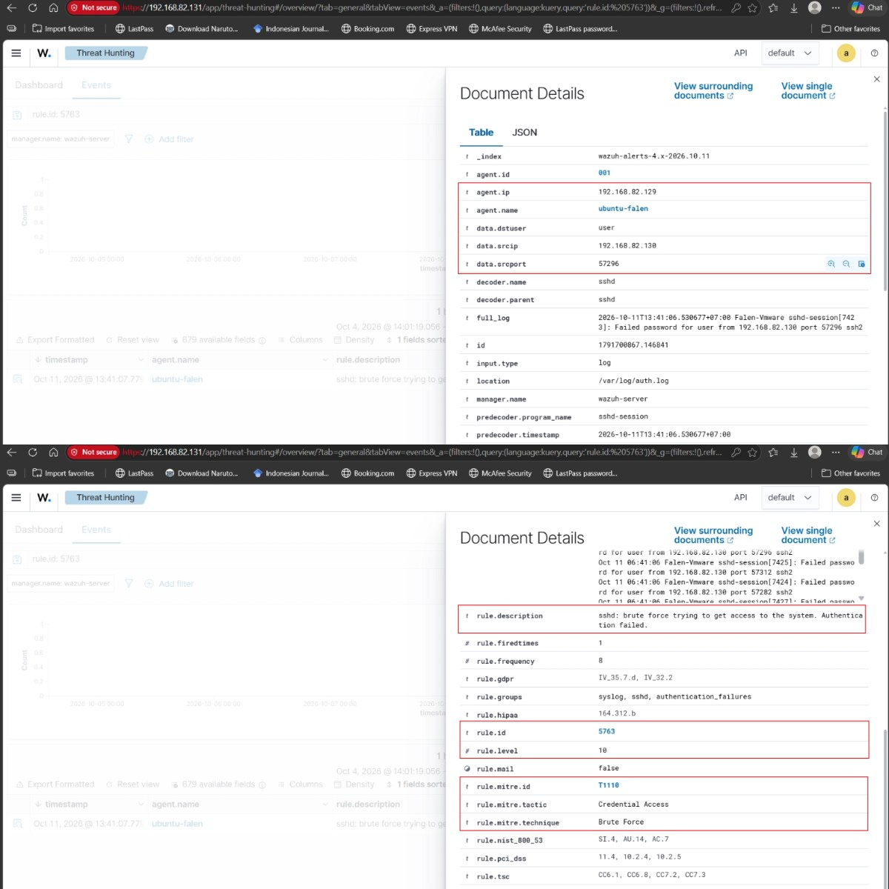
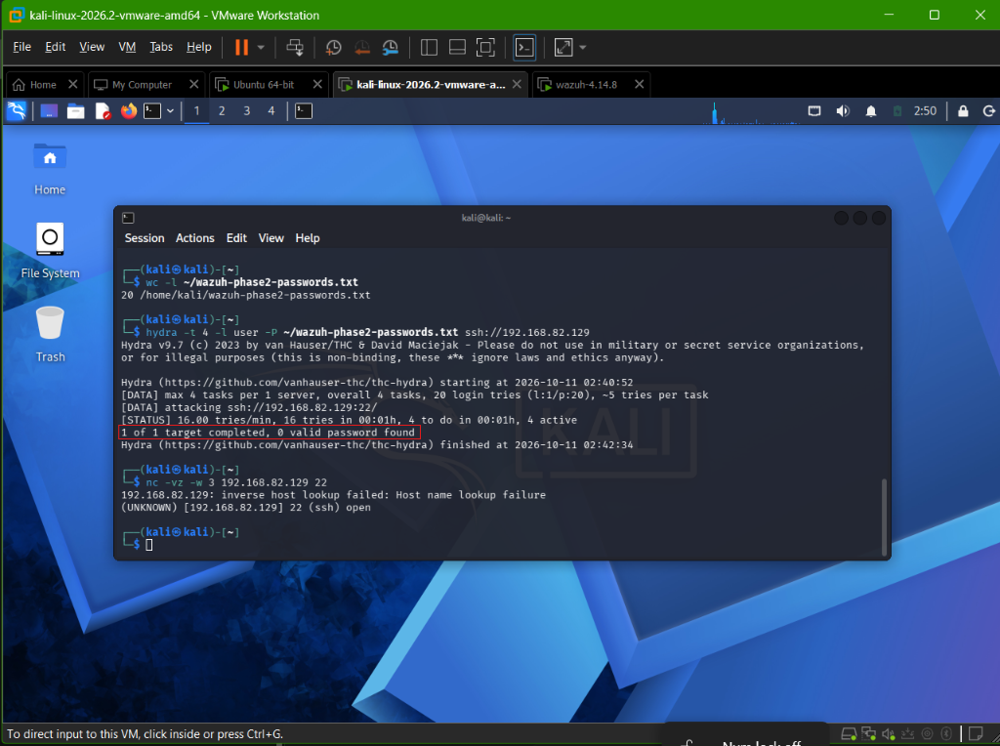
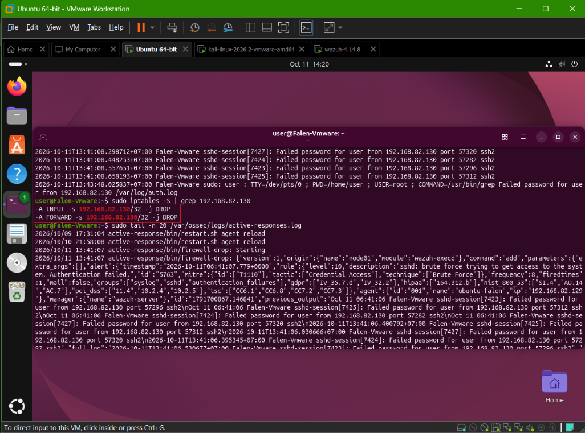

# Incident Investigation & Response Report
## SSH Brute-Force Detection and Automated Response with Wazuh

**Language:** Bahasa Indonesia | [English Version](incident-response-report.md)

## 1. Executive Summary

Simulasi SSH brute-force terkontrol dilakukan di lingkungan lab VMware. Kali Linux (`192.168.82.130`) mengirimkan percobaan autentikasi berulang ke layanan SSH pada Ubuntu (`192.168.82.129`) dengan username target `user` dan kata sandi yang salah. Endpoint Ubuntu dipantau oleh Wazuh Agent yang terhubung ke Wazuh Server (`192.168.82.131`).

Wazuh menghasilkan alert rule `5763` level 10 untuk pola SSH brute-force dan menjalankan Active Response `firewall-drop`. Pemeriksaan pada endpoint menunjukkan aturan `DROP` untuk source IP tersebut. Verifikasi akhir menunjukkan tidak ada block aktif. Verifikasi akhir juga menunjukkan layanan SSH dan Wazuh Agent tetap aktif, dengan `PasswordAuthentication no` dan `MaxAuthTries 3`.

Output simulasi Hydra menunjukkan `0 valid password found`. Tidak ditemukan bukti login berhasil atau privilege escalation yang terkait pada artefak yang diperiksa. Kesimpulan ini berlaku untuk rentang waktu dan bukti lab yang tersedia.

## 2. Lab Architecture and Agent Status

```text
Kali Linux - 192.168.82.130
        |
        | Controlled SSH authentication simulation
        v
Ubuntu endpoint - 192.168.82.129
        |
        | Wazuh agent (ubuntu-falen, ID 001)
        v
Wazuh Server - 192.168.82.131
  ├── Wazuh Manager
  ├── Wazuh Indexer
  └── Wazuh Dashboard
```

Semua alamat tersebut merupakan alamat privat pada lab. Kali menjadi sumber simulasi, Ubuntu menjadi endpoint yang diawasi sekaligus tempat respons firewall diterapkan, sedangkan Wazuh Server mengumpulkan dan menganalisis alert.

### Dashboard awal



*Evidence: Dashboard Wazuh pada alamat lab 192.168.82.131 sebelum agent diregistrasikan.*

### Registrasi dan status agent



*Evidence: Output terminal Wazuh yang mencantumkan agent ubuntu-falen berstatus Active.*



*Evidence: Wazuh Dashboard yang menampilkan ubuntu-falen, agent ID 001, endpoint 192.168.82.129, status active.*

## 3. Detection

Wazuh Agent mengirimkan telemetry autentikasi dari `/var/log/auth.log` pada Ubuntu. Alert yang terlihat pada Wazuh Dashboard memiliki parameter berikut:

| Parameter | Nilai |
|---|---|
| Rule ID | `5763` |
| Rule description | `sshd: brute force trying to get access to the system. Authentication failed.` |
| Rule level | `10` |
| Rule frequency / timeframe | `8` event / `120` detik pada definisi rule |
| Source IP | `192.168.82.130` |
| Target endpoint | `192.168.82.129` |
| Target username | `user` |
| Service | SSH |
| MITRE ATT&CK | `T1110 - Brute Force` |
| Agent | `ubuntu-falen` (`001`) |

File investigasi memuat delapan baris `Failed password` dari source IP yang sama antara `13:41:06` dan `13:41:08 WIB`. Dashboard mencatat alert rule `5763` pada `11 Oktober 2026, 13:41:07.779 WIB`. Definisi rule yang diperiksa pada ruleset menunjukkan frekuensi 8 event pada jangka waktu 120 detik.

Meskipun frekuensi rule adalah 8, alert dihasilkan pada percobaan gagal ke-4, bukan ke-8. `full_log` alert adalah baris yang dicatat pada `13:41:06.530677` (source port `57296`), sedangkan percobaan gagal ke-5 sampai ke-8 tercatat pada `13:41:08`, setelah alert dan setelah Active Response mulai pada `13:41:07`. Log Active Response menjelaskan mengapa hitungan tercapai lebih awal: `previous_output` dan `full_log` bersama-sama memuat setiap dari empat percobaan pertama dua kali, sekali dalam format journald (`Oct 11 06:41:06 ...`) dan sekali dalam format `auth.log` (`2026-10-11T13:41:06...+07:00`). File `ossec.conf` pada agent membaca `/var/log/auth.log` sekaligus `journald`, sehingga event sshd yang sama sampai ke manager melalui dua sumber dan dihitung dua kali terhadap frekuensi 8. Baris terpilih dari output `sudo grep -n -B1 -A2 "auth.log\|journald" /var/ossec/etc/ossec.conf`:

```
190:    <location>/var/log/auth.log</location>
198:    <location>journald</location>
223:    <location>/var/log/auth.log</location>
```

Baris Active Response tersimpan di `evidence/phase2-wazuh/active-responses-excerpt.log`. Pengumpulan ganda ini tidak diperbaiki sebelum simulasi, sehingga hasilnya menggambarkan lab sesuai konfigurasi saat itu.

### Definisi rule yang diperiksa pada ruleset



*Evidence: Definisi rule 5763 di ruleset Wazuh yang dipasang.*

### Baris log autentikasi mentah pada Ubuntu



*Evidence: Baris auth.log pada Ubuntu yang mencatat Failed password dari 192.168.82.130.*

### Alert di Threat Hunting



*Evidence: Threat Hunting menampilkan alert rule 5763, level 10, pada agent ubuntu-falen.*

### Detail alert



*Evidence: Detail alert: source IP, username user, rule frequency, dan pemetaan MITRE ATT&CK T1110.*

## 4. Investigation

Investigasi mencocokkan alert Wazuh dengan log autentikasi endpoint dan status respons. Artefak dan metode yang digunakan meliputi:

- Wazuh Dashboard / Threat Hunting untuk melihat rule ID, level, username, source IP, timestamp, dan metadata MITRE ATT&CK.
- `/var/log/auth.log` dan `source-ip-investigation.log` untuk menelusuri kegagalan autentikasi dan koneksi sebelum autentikasi.
- Output Hydra untuk memastikan tidak ada kata sandi valid yang ditemukan oleh simulasi.
- `/var/ossec/logs/active-responses.log` pada screenshot untuk melihat pemanggilan `firewall-drop`.
- `iptables -S` untuk memeriksa aturan firewall sementara.
- `response-verification.txt` untuk memeriksa status SSH, Wazuh Agent, hardening autentikasi, dan keberadaan block.

### Output simulasi Hydra



*Evidence: Output simulasi Hydra: 0 valid password found dan gambar yang sama juga memuat hasil pemeriksaan nc.*

Source IP yang teridentifikasi sebagai `192.168.82.130`, yaitu Kali Linux pada lab yang sama. Username yang diuji adalah `user`, jangan disamakan dengan target akun `test` dari simulasi Phase 1.

Tidak ditemukan `Accepted password` atau `Accepted publickey` dari source tersebut dalam potongan log investigasi untuk percobaan ini. Bukti yang dikumpulkan juga tidak menunjukkan privilege escalation yang terkait. Penilaian ini dibatasi pada artefak yang diperiksa dan tidak dimaksudkan sebagai pembuktian menyeluruh atas seluruh kemungkinan dampak.

## 5. Impact Assessment

- **Akses ke akun:** Output Hydra menunjukkan `0 valid password found`dan log autentikasi yang dikumpulkan hanya menunjukkan kegagalan.
- **Privilege escalation:** Tidak ditemukan bukti aktivitas privilege escalation yang berkaitan dengan source IP dalam artefak yang ditinjau.
- **Layanan:** SSH tetap aktif pada pemeriksaan akhir. Screenshot terminal Kali memuat output `nc` yang melaporkan TCP/22 open (lihat Section 7).
- **Ruang lingkup dampak:** Insiden merupakan simulasi lab terkontrol, tidak ada indikasi bukti yang diberikan mengenai dampak pada sistem produksi.

## 6. Containment

Setelah pola autentikasi terdeteksi, Wazuh Active Response menjalankan `firewall-drop`. Screenshot terminal Ubuntu menunjukkan log `active-response/bin/firewall-drop: Starting` dan aturan `iptables` yang menjatuhkan (`DROP`) trafik dari `192.168.82.130`.



*Evidence: Log Active Response menunjukkan firewall-drop mulai dijalankan dan output iptables memperlihatkan aturan DROP untuk 192.168.82.130.*

Hal ini mendukung kesimpulan bahwa block sementara benar-benar diterapkan pada endpoint. Respons ditujukan ke source IP yang teridentifikasi pada lab. Mekanisme ini merupakan pembatasan koneksi sementara, bukan pengganti hardening SSH atau pengamanan kredensial.

## 7. Recovery

Konfigurasi Active Response menggunakan timeout `180` detik. Bukti pemulihan yang tersedia adalah:

- Output verifikasi akhir menunjukkan `No active block` untuk source IP.
- Log Active Response mencatat perintah `delete` untuk `firewall-drop` pada `13:44:08`, 181 detik setelah block dipasang pada `13:41:07`, sesuai timeout 180 detik (`evidence/phase2-wazuh/active-responses-excerpt.log`).
- Screenshot terminal Kali memuat hasil `nc` yang melaporkan TCP/22 open. Kali memakai timezone `America/New_York` (UTC-4) sedangkan Ubuntu dan Wazuh memakai WIB (UTC+7), selisih 11 jam (`timedatectl` di Kali, dijalankan pada 30 Oktober 2026 dengan offset EDT yang sama, menunjukkan `Time zone: America/New_York (EDT, -0400)`). Dengan selisih itu, Hydra (`02:40:52`-`02:42:34` di Kali) setara `13:40:52`-`13:42:34` WIB, berada di dalam marker `incident-start.txt` (`13:40:33`) dan `incident-end.txt` (`13:43:01`) di Ubuntu. Screenshot tidak menampilkan waktu `nc` dijalankan, satu-satunya koneksi lanjutan dari source di `auth.log` adalah `Connection closed by 192.168.82.130` pada `13:44:26`, setelah block dicabut, yang konsisten dengan pemeriksaan `nc`, tetapi kaitan ini bersifat inferensi.
- `systemctl` check yang direkam menunjukkan `ssh` dan `wazuh-agent` sama-sama `active`.
- Konfigurasi hardening SSH telah dikembalikan: `PasswordAuthentication no` dan `maxauthtries 3`, baris `PerSourcePenalties` pada file verifikasi juga menunjukkan parameter yang dipulihkan.

Status endpoint setelah response disimpulkan dari log Active Response (block dicabut pada `13:44:08`), pengecekan no-active-block, dan SSH aktif.

## 8. Limitations

- Pengujian menggunakan satu endpoint Ubuntu yang dipantau dan satu endpoint Kali sebagai sumber simulasi.
- Wazuh dipasang pada satu server lab, skenario ini tidak mencakup korelasi multi-endpoint skala enterprise, integrasi identity provider, tiket insiden terpusat, atau platform SOAR terpisah.
- Kali memakai timezone yang berbeda (UTC-4, sedangkan Ubuntu dan Wazuh memakai WIB, UTC+7). Waktu Hydra hanya dipakai sebagai informasi pendukung, dan timeline mengacu pada timestamp Ubuntu dan Wazuh.
- Rule terpicu pada empat percobaan gagal yang berbeda, bukan delapan, karena sumber log ganda yang dijelaskan di Section 3. Konfigurasi `localfile` tidak diubah dan simulasi tidak diulang.
- Kesimpulan dibatasi pada log dan screenshot yang disertakan. Ketiadaan bukti dalam artefak terbatas bukan bukti mutlak bahwa semua kategori dampak tidak mungkin terjadi.

## 9. Lessons Learned

Project ini menunjukkan alur dasar operasi keamanan:

**Detection → Triage → Investigation → Containment → Verification → Recovery → Reporting**

Phase 1 menggunakan skrip Python sederhana untuk mengorelasikan kegagalan autentikasi dari log lokal dan menghasilkan alert JSON. Phase 2 menambahkan pengumpulan event terpusat dengan Wazuh, alert rule untuk pola brute-force, dan respons firewall otomatis. Simulasi awal juga memperlihatkan bahwa pengaturan hardening OpenSSH dapat membatasi percobaan autentikasi. Sehingga hardening dilonggarkan sementara hanya untuk pengujian terkontrol lalu dipulihkan dan diverifikasi kembali.

Hasil ini memperlihatkan bahwa hardening endpoint dan monitoring memiliki fungsi yang saling melengkapi: hardening membatasi percobaan autentikasi, sementara SIEM membantu mengidentifikasi pola yang memenuhi rule deteksi dan memulai respons yang dapat diverifikasi. Investigasi ini juga menunjukkan bahwa jumlah event pada alert perlu dicocokkan dengan log mentah: perbandingan `full_log` dan `previous_output` dengan `auth.log` memperlihatkan bahwa satu sumber log terkumpul dua kali.
