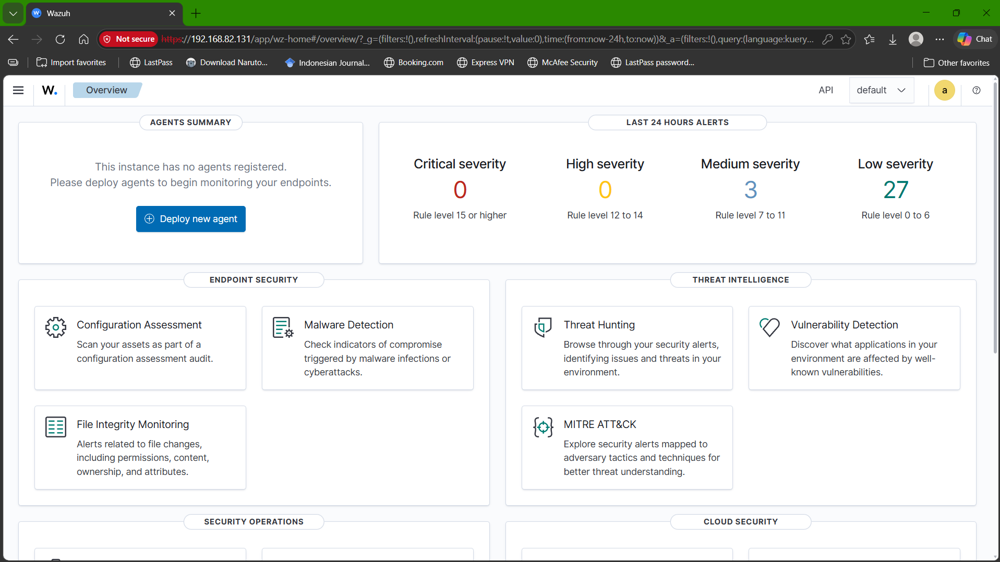
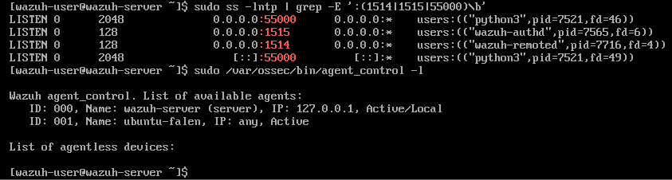
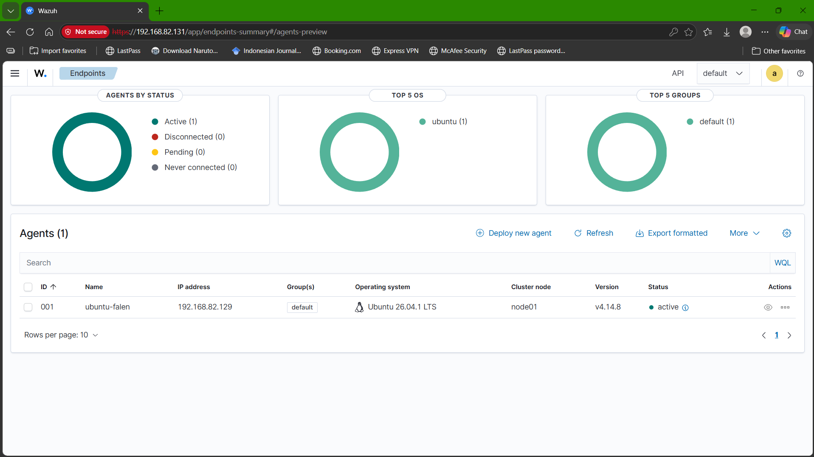
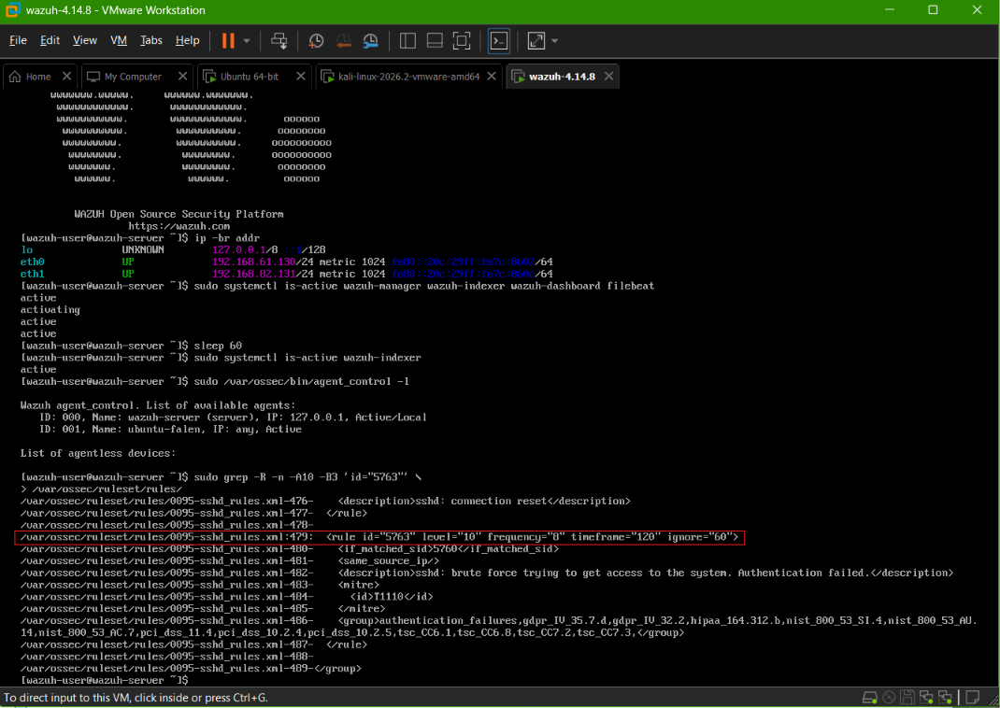
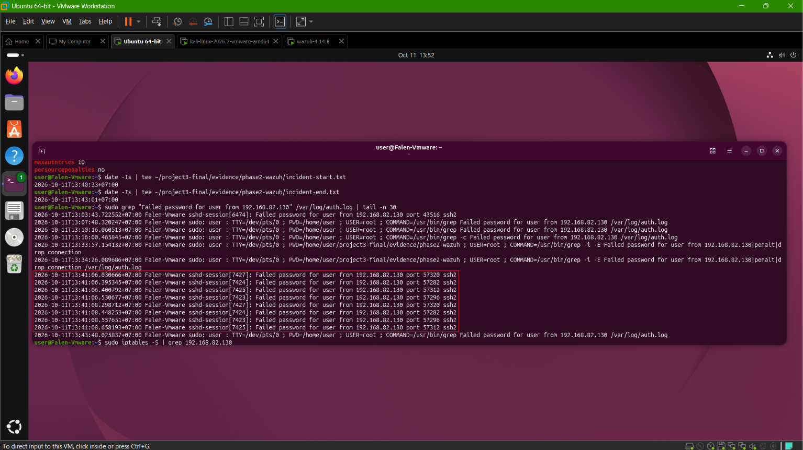
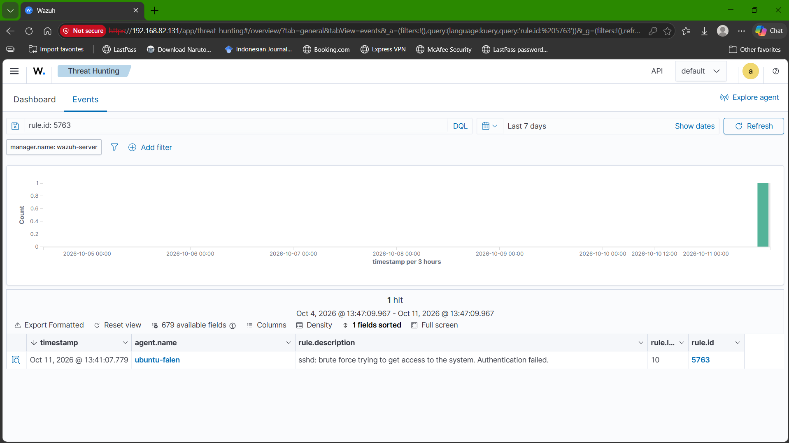
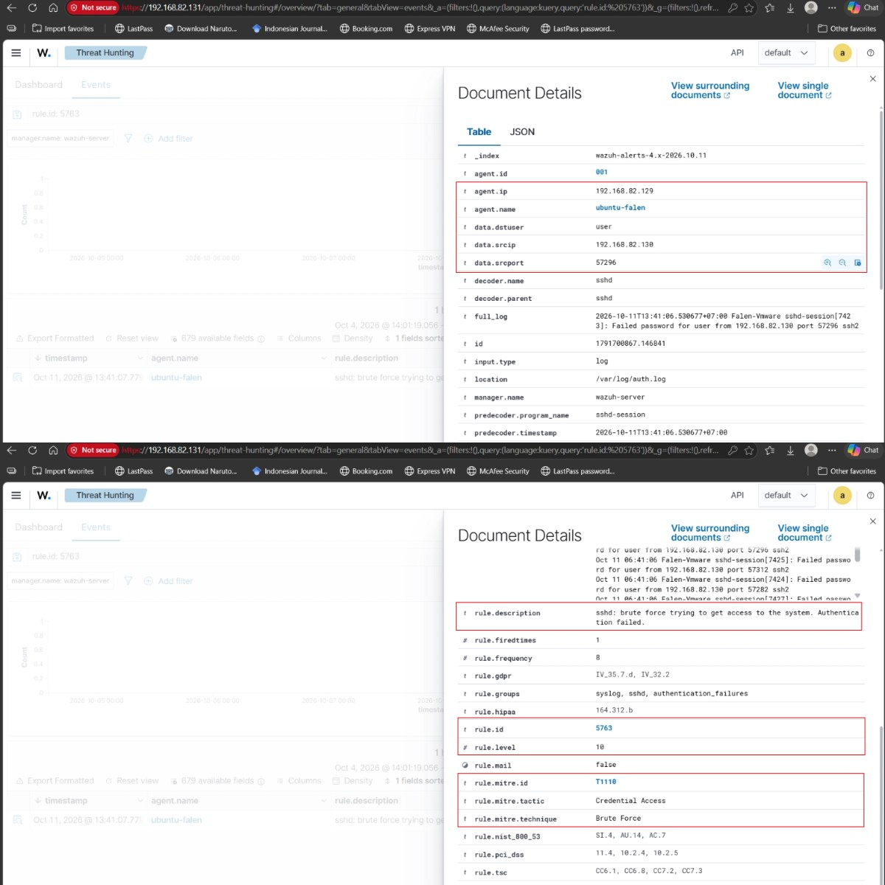
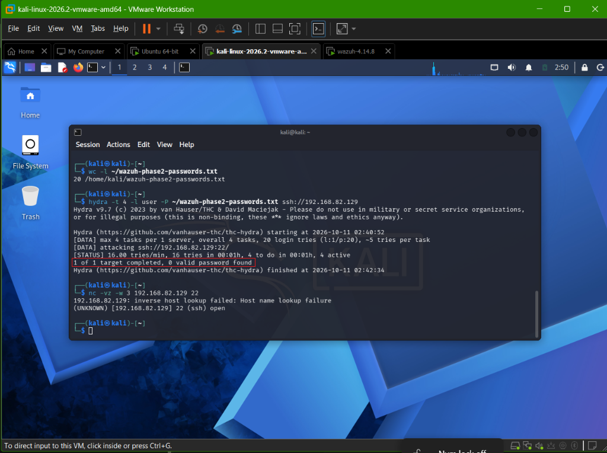
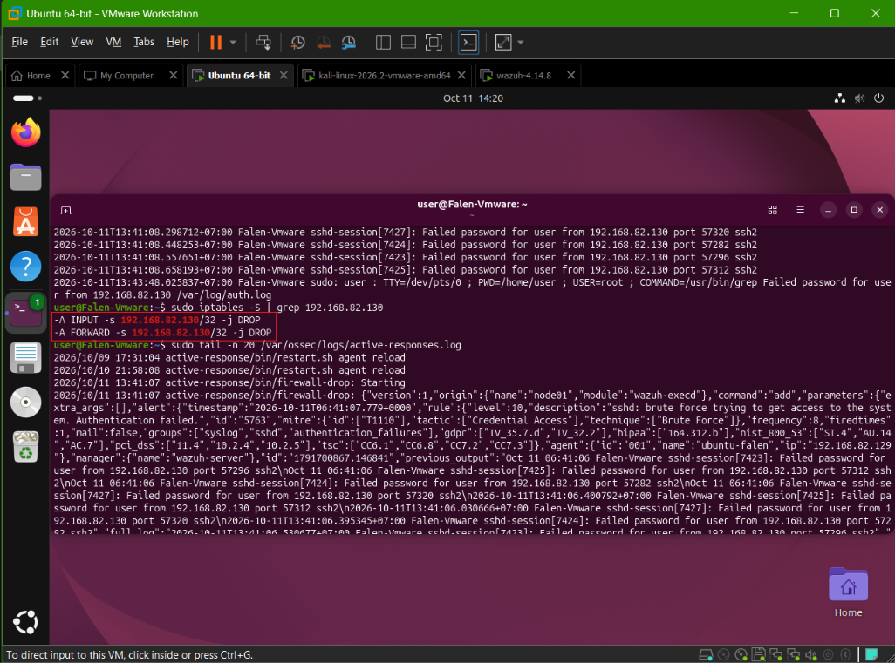

# Incident Investigation & Response Report
## SSH Brute-Force Detection and Automated Response with Wazuh

**Language:** English | [Versi Bahasa Indonesia](incident-response-report.id.md)

## 1. Executive Summary

A controlled SSH authentication simulation was conducted in a VMware lab. Kali Linux (`192.168.82.130`) repeatedly attempted to authenticate to the Ubuntu SSH service (`192.168.82.129`) using the username `user` and incorrect passwords. The Ubuntu endpoint was monitored by Wazuh Agent `ubuntu-falen`, connected to the Wazuh server at `192.168.82.131`.

Wazuh generated a level-10 alert under rule `5763` for the SSH brute-force pattern and invoked the `firewall-drop` Active Response. Ubuntu firewall inspection showed `DROP` rules for the source IP. Final endpoint verification recorded no active block, while SSH and the Wazuh Agent remained active. SSH hardening was restored, including `PasswordAuthentication no` and `MaxAuthTries 3`. Hydra reported `0 valid password found`. No evidence of successful authentication or related privilege escalation was found in the artifacts reviewed, this conclusion is limited to the available lab evidence.

## 2. Lab Architecture and Agent Status

```text
Kali Linux - 192.168.82.130
        |
        | Controlled SSH authentication simulation
        v
Ubuntu endpoint - 192.168.82.129
        |
        | Wazuh Agent: ubuntu-falen (ID 001)
        v
Wazuh Server - 192.168.82.131
  ├── Wazuh Manager
  ├── Wazuh Indexer
  └── Wazuh Dashboard
```

These are private addresses within the lab. Kali is the simulation source, Ubuntu is the monitored endpoint and location of the firewall response, and Wazuh provides centralized event monitoring.

### Initial dashboard



*Evidence: Wazuh Dashboard on the lab address 192.168.82.131 before endpoint registration.*

### Agent registration and active status



*Evidence: Wazuh terminal output listing ubuntu-falen as Active.*



*Evidence: Wazuh Dashboard showing agent ID 001, endpoint 192.168.82.129, and active status.*

## 3. Detection

Wazuh collected Ubuntu authentication telemetry from `/var/log/auth.log`. The alert and installed rule definition showed the following details:

| Parameter | Value |
|---|---|
| Rule ID | `5763` |
| Description | `sshd: brute force trying to get access to the system. Authentication failed.` |
| Rule level | `10` |
| Rule frequency / timeframe | 8 events / 120 seconds in the installed rule definition |
| Source IP | `192.168.82.130` |
| Target endpoint | `192.168.82.129` |
| Target username | `user` |
| Service | SSH |
| MITRE ATT&CK | `T1110 - Brute Force` |
| Agent | `ubuntu-falen` (`001`) |

The collected incident log contains 8 `Failed password` entries from the source IP over approximately `13:41:06-13:41:08 WIB`. Wazuh Threat Hunting displayed the rule `5763` alert at `11 October 2026, 13:41:07.779 WIB`.

### Rule definition checked in the installed ruleset



*Evidence: Installed ruleset excerpt showing rule 5763 and its frequency/timeframe values.*

### Raw Ubuntu authentication events



*Evidence: Raw auth.log lines showing failed SSH password attempts from 192.168.82.130 for username user.*

### Alert in Threat Hunting



*Evidence: Threat Hunting result for rule 5763, rule level 10, and agent ubuntu-falen.*

### Alert details



*Evidence: Expanded alert fields including source IP, target username, rule frequency, and MITRE ATT&CK T1110.*

## 4. Investigation

The investigation correlated Wazuh alert details with Ubuntu authentication logs, the Hydra output, firewall state, and final endpoint verification. The targeted username in Phase 2 was `user`and it should not be confused with username `test` from the separate Phase 1 simulation.

### Hydra simulation output



*Evidence: Hydra reports 0 valid password found. The same terminal capture includes an nc check, the nc result is interpreted separately below.*

## 5. Impact Assessment

- **Authentication outcome:** Hydra reported `0 valid password found`. The collected log excerpt shows failed authentication events. No `Accepted password` or `Accepted publickey` event from the source was found in the reviewed excerpt for this attempt.
- **Privilege escalation:** the collected artifacts did not show related privilege-escalation evidence. This is limited to the available evidence and review window.
- **Service availability:** SSH and the Wazuh Agent remained active in final verification.
- **Scope:** this was a controlled lab exercise and does not indicate an impact on a production system.

## 6. Containment

After the rule triggered, Wazuh Active Response invoked `firewall-drop`. The Ubuntu terminal screenshot shows the response starting and firewall rules that drop traffic from `192.168.82.130`. This supports that a temporary source-IP block was applied at the monitored endpoint.



*Evidence: Active Response log entry and iptables DROP rules for source 192.168.82.130.*

## 7. Recovery

The Active Response configuration used a timeout of `180` seconds. The saved final endpoint verification records:

```text
SSH: active
WAZUH AGENT: active
PasswordAuthentication no
MaxAuthTries: 3
ACTIVE RESPONSE BLOCK: No active block
```

These results support that the host was left in a hardened state and that no source-IP block remained at the time of the final check.

The `nc` output is visible in the terminal screenshot in **Section 4 - Hydra simulation output** (`04-hydra-no-valid-password.png`). The separately uploaded `nc succeeded.png` was byte-for-byte identical to that image, so the duplicate is stored only once.

The message `inverse host lookup failed: Host name lookup failure` refers to the reverse-DNS lookup, while the later line explicitly reports TCP/22 as `open`. The screenshot supports reachability at the time it was captured. Its clock cannot be aligned precisely with Ubuntu/Wazuh timestamps, so it is not treated as standalone proof of the exact moment immediately after the block timeout. The final `No active block` result is recorded separately in `evidence/phase2-wazuh/response-verification.txt`.

The submitted ZIP does not contain the full text of `active-responses.log` after the timeout. For that reason, this report does not claim an exact deletion timestamp for the firewall rule.

## 8. Limitations

- The lab contains one monitored Ubuntu endpoint and one Kali simulation source.
- It does not implement enterprise-scale multi-endpoint correlation, enterprise identity integration, a central ticketing workflow, or a separate SOAR platform.
- Hydra's terminal clock cannot be reconciled confidently with Ubuntu/Wazuh timestamps, so it is not used to assign exact detection chronology.
- Full post-timeout `active-responses.log` text was not included in the submitted archive. The available proof includes the response-start screenshot, firewall rules, final no-active-block verification, and the separate TCP/22 reachability screenshot.
- Conclusions are bounded by the retained logs and screenshots, absence of evidence in this limited set is not proof that every possible impact is impossible.

## 9. Lessons Learned

The lab demonstrates the workflow **Detection → Triage → Investigation → Containment → Verification → Recovery → Reporting**. Phase 1 implements local log analysis and custom threshold detection in Python. Phase 2 adds centralized collection and rule-based alerting with Wazuh, followed by temporary firewall containment. The exercise also demonstrates that SSH hardening and monitoring complement each other: hardening reduces authentication exposure, while monitoring helps identify repeated failures and trigger a response that can be verified.
